# 基于微信小程序的社区志愿者服务平台 8xh87

> 🎓 **计算机毕业设计 · 基于微信小程序的社区志愿者服务平台 8xh87**
>
> 本仓库只放**项目介绍 + 运行截图**（截图是站点带水印的原图，存在仓库 `images/` 里）。
>
> 👉 **完整可运行源码 / 数据库脚本 / 部署文档：[点我获取](https://geekcode.top/archives/%E5%9F%BA%E4%BA%8E%E5%BE%AE%E4%BF%A1%E5%B0%8F%E7%A8%8B%E5%BA%8F%E7%9A%84%E7%A4%BE%E5%8C%BA%E5%BF%97%E6%84%BF%E8%80%85%E6%9C%8D%E5%8A%A1%E5%B9%B3%E5%8F%B0-8xh87?utm_source=github)**
>
> 💬 咨询微信：**ir9372**　|　🌐 更多项目：[极客代码 geekcode.top](https://geekcode.top/?utm_source=github)
>
> 📌 项目详情页：<https://geekcode.top/archives/%E5%9F%BA%E4%BA%8E%E5%BE%AE%E4%BF%A1%E5%B0%8F%E7%A8%8B%E5%BA%8F%E7%9A%84%E7%A4%BE%E5%8C%BA%E5%BF%97%E6%84%BF%E8%80%85%E6%9C%8D%E5%8A%A1%E5%B9%B3%E5%8F%B0-8xh87?utm_source=github>

<table><td width="230" align="center"> <b>扫码加微信 ir9372</b></td><td valign="middle">📦 源码 = 项目介绍 + 全部运行截图 + 数据库 + 部署文档 👉 点上方任意截图，直接跳到 <b>极客代码 geekcode.top</b> 详情页</td></table>

---

<h1>基于微信小程序的社区志愿者服务平台 _8xh87</h1>
<h2>项目概述</h2>

本项目旨在构建一个基于微信小程序的社区志愿者服务平台，以数字化手段优化社区志愿服务的管理与参与流程。系统采用前后端分离架构，前端通过微信小程序为社区居民提供便捷的入口，后端基于 Java 技术栈实现业务逻辑处理与数据持久化。核心功能涵盖志愿者活动发布、在线报名、现场签到、活动风采展示、证书信息管理以及文章资讯浏览等模块。适用人群包括社区管理员、志愿者组织者及普通居民用户。通过该平台，能够有效解决传统线下志愿活动信息不对称、报名统计繁琐、服务记录难以追溯等痛点，提升社区志愿服务的组织效率与管理水平，促进社区和谐共建。

<h2>技术架构</h2>

本系统采用经典的 B/S 架构结合移动端小程序开发模式，整体技术选型注重稳定性、扩展性及开发效率。

<strong>1. 后端架构</strong>
后端基于 Spring Boot 框架构建，利用其自动配置特性快速搭建微服务基础环境。持久层采用 MyBatis-Plus 框架，在 MyBatis 基础上提供了强大的 CRUD 操作封装和条件构造器，大幅减少 SQL 编写工作量。数据库连接池选用 Druid，具备高效的监控功能和防御 SQL 注入的能力。依赖组件包括 spring-core, spring-context, spring-webmvc 等，确保 MVC 分层结构的清晰与事务管理（spring-tx）的完整性。控制器层包含 CommonController, ConfigController 及各业务模块 Controller（如 HuodongbaomingController, ShequController 等），负责接收请求并调用 Service 层逻辑。

<strong>2. 前端架构</strong>
前端分为两部分：

<ul>
<li><strong>用户端</strong>：基于微信小程序原生或 Vue 集成方案（vue-integrated），通过 HTTP 请求与后端 API 交互，提供轻量级、无需安装即可使用的用户体验。</li>
<li><strong>管理端</strong>：基于 Web 浏览器访问，使用 Vue.js 框架构建后台管理系统，路由设计清晰，涵盖 <code>/zhiyuanzhehuodong</code>（志愿者活动）、<code>/huodongqiandao</code>（活动签到）等核心管理页面。</li>
</ul>

<strong>3. 数据库设计要点</strong>
数据库主要围绕“人”、“事”、“物”进行建模。核心表结构预计包括：用户表（区分普通用户、志愿者、管理员）、社区表（Shequ）、活动类型表（Huodongleixing）、志愿者活动主表（Zhiyuanzhehuodong）、活动报名表（Huodongbaoming）、活动签到表（Huodongqiandao）、证书信息表（Zhengshuxinxi）、文章资讯表（Wenzhangzixun）及评论表（Discuss...）。各表之间通过外键关联，例如报名表关联活动 ID 和用户 ID，确保数据的一致性与完整性。

<h2>功能模块</h2>

根据源码中的 Controller 列表及截图功能展示，系统主要分为前台用户端（微信小程序）和后台管理端两大模块。

<h3>1. 前台用户端（微信小程序）</h3>
<ul>
<li><strong>首页展示</strong>：聚合展示最新的志愿者活动、热门文章资讯及社区公告，提供快捷导航入口。</li>
<li><strong>志愿者活动浏览</strong>：展示活动详情，包括活动时间、地点、要求及剩余名额，支持按类型筛选。</li>
<li><strong>活动报名</strong>：用户选择心仪的活动提交报名信息，系统记录报名状态。</li>
<li><strong>活动签到</strong>：活动现场通过二维码或手动方式完成签到，记录参与时长或服务次数。</li>
<li><strong>活动风采</strong>：查看过往活动的图片、视频及文字报道，了解社区志愿服务成果。</li>
<li><strong>证书信息管理</strong>：查看个人获得的志愿服务电子证书，支持下载或分享。</li>
<li><strong>文章资讯</strong>：阅读社区发布的新闻、政策指南或志愿者故事。</li>
<li><strong>互动评论</strong>：对志愿者活动、文章资讯及活动风采发表评论，增强社区互动性。</li>
<li><strong>个人中心</strong>：</li>
<li><strong>个人信息</strong>：修改头像、昵称、联系方式等基本资料。</li>
<li><strong>我的收藏</strong>：收藏感兴趣的活动或文章，方便后续快速访问。</li>
<li><strong>我的报名/签到</strong>：查看个人的历史报名记录和签到情况。</li>
<li><strong>登录/注册</strong>：新用户注册账号，老用户通过微信授权或账号密码登录。</li>
</ul>
<h3>2. 后台管理端（Web Admin）</h3>
<ul>
<li><strong>系统配置</strong>：管理网站基本参数、轮播图设置及权限配置（ConfigController）。</li>
<li><strong>社区管理</strong>：维护社区基本信息，包括名称、地址、负责人等（ShequController）。</li>
<li><strong>志愿者管理</strong>：审核志愿者资质，管理志愿者档案，查看志愿者服务记录。</li>
<li><strong>活动类型管理</strong>：定义和维护志愿服务活动的分类标签（HuodongleixingController）。</li>
<li><strong>志愿者活动管理</strong>：发布、编辑、下架志愿服务活动，设置报名规则和时间窗口（ZhiyuanzhehuodongController）。</li>
<li><strong>活动报名管理</strong>：审核用户的报名申请，导出报名名单，处理取消报名请求（HuodongbaomingController）。</li>
<li><strong>活动签到管理</strong>：监控活动当天的签到情况，手动补签或异常数据处理（HuodongqiandaoController）。</li>
<li><strong>证书信息管理</strong>：生成、颁发和管理志愿者的服务证书，设定发证标准（ZhengshuxinxiController）。</li>
<li><strong>活动风采管理</strong>：上传和管理活动回顾的照片、视频及图文内容（HuodongfengcaiController）。</li>
<li><strong>文章资讯管理</strong>：发布社区新闻、通知公告及宣传文章（WenzhangzixunController）。</li>
<li><strong>评论管理</strong>：审核用户在前台发表的评论内容，删除违规言论，维护社区秩序（DiscusshuodongfengcaiController, DiscusswenzhangzixunController, DiscusszhiyuanzhehuodongController）。</li>
<li><strong>收藏管理</strong>：查看用户的收藏记录，用于数据分析（StoreupController）。</li>
<li><strong>文件管理</strong>：处理图片、文档等资源的上传与存储（FileController）。</li>
</ul>
<h2>用户角色与权限</h2>

系统主要涉及两种角色：普通用户（含志愿者）和系统管理员。

<table>
<thead>
<tr>
<th align="left">角色</th>
<th align="left">权限描述</th>
<th align="left">可访问功能模块</th>
</tr>
</thead>
<tbody><tr>
<td align="left"><strong>普通用户/志愿者</strong></td>
<td align="left">面向社区成员，拥有参与志愿服务、获取信息及互动的权限。需登录后方可使用大部分功能。</td>
<td align="left"><strong>小程序端</strong>：1. 浏览首页、活动列表、文章资讯。2. 报名参加活动、进行现场签到。3. 查看个人证书、我的收藏、报名及签到记录。4. 发表对活动、文章、风采的评论。5. 修改个人信息、注册/登录。<strong>后台端</strong>：无直接访问权限（除非被赋予特定志愿者管理角色，但根据常规设计，普通用户仅通过小程序交互）。</td>
</tr>
<tr>
<td align="left"><strong>系统管理员</strong></td>
<td align="left">平台最高权限持有者，负责整个社区志愿者服务平台的数据维护、内容审核及系统配置。</td>
<td align="left"><strong>后台管理端</strong>：1. <strong>基础数据管理</strong>：社区信息、活动类型、志愿者档案。2. <strong>业务管理</strong>：发布/编辑志愿者活动、审核报名、处理签到数据、颁发证书。3. <strong>内容运营</strong>：发布文章资讯、上传活动风采素材。4. <strong>互动监管</strong>：审核和管理所有板块（活动、文章、风采）的用户评论。5. <strong>系统设置</strong>：配置文件参数、查看收藏数据统计。<strong>小程序端</strong>：通常不直接作为普通用户身份使用，或通过特定入口进入“管理端视图”（截图中提及“小程序-管理端”，表明管理员可能通过小程序移动办公）：1. 查看志愿者列表、社区列表。2. 审核活动类型、文章资讯。</td>
</tr>
</tbody></table>

<em>注：根据截图“小程序-管理端”的存在，推测管理员也可通过微信小程序进行部分高频管理操作，如查看列表和简单审核，具体权限边界取决于后端接口鉴权配置。</em>

<h2>项目特色与创新点</h2>
<ol>
<li><strong>全流程数字化闭环</strong>：实现了从“活动发布 -&gt; 用户报名 -&gt; 现场签到 -&gt; 证书颁发 -&gt; 风采展示 -&gt; 互动评价”的完整志愿服务生命周期管理，消除了纸质记录和人工统计的低效环节。</li>
<li><strong>多端协同体验</strong>：创新性地将管理端功能延伸至微信小程序（小程序-管理端），使社区工作人员能够随时随地通过手机进行志愿者审核、活动管理等操作，提升了管理的灵活性和响应速度。</li>
<li><strong>精细化内容运营</strong>：不仅关注活动本身，还引入了“文章资讯”和“活动风采”模块，配合“评论”功能，构建了活跃的社区文化圈层，增强了用户对平台的粘性和归属感。</li>
<li><strong>可信服务记录体系</strong>：通过“活动签到”与“证书信息”的强关联，建立了不可篡改的志愿服务时长记录机制，为志愿者评优、积分兑换或社会认可提供了真实可靠的数据支撑。</li>
<li><strong>轻量化接入优势</strong>：依托微信小程序生态，用户无需下载安装 App，扫码即用，极大降低了老年群体及非重度互联网用户的使用门槛，符合社区服务的普惠性原则。</li>
</ol>
<h2>部署环境</h2>

为确保系统正常运行，服务器及开发环境需满足以下软件版本要求：

<ul>
<li><strong>操作系统</strong>：Linux (CentOS 7+/Ubuntu 20.04+) 或 Windows Server 2016+</li>
<li><strong>Java 运行环境</strong>：JDK 1.8 或 JDK 11（推荐 JDK 1.8 以兼容主流 Spring Boot 版本）</li>
<li><strong>数据库</strong>：MySQL 5.7 或 MySQL 8.0（需启用 InnoDB 引擎，字符集建议 utf8mb4）</li>
<li><strong>缓存/中间件</strong>：Redis（可选，若涉及会话共享或高并发计数；根据现有依赖未明确强制要求，但 Druid 监控需要数据库支持）</li>
<li><strong>前端构建工具</strong>：Node.js (v14.x 或 v16.x)，npm 或 yarn</li>
<li><strong>小程序开发工具</strong>：微信开发者工具（最新稳定版）</li>
<li><strong>Web 服务器</strong>：Nginx（用于反向代理静态资源及 HTTPS 证书配置）</li>
<li><strong>应用容器</strong>：内置 Tomcat（Spring Boot 默认）或独立安装的 Apache Tomcat 9.0+</li>
</ul>
<h2>五、技术特性</h2>
<ul>
<li>前后端集成部署，前端资源打包至后端 static 目录</li>
<li>使用 MyBatis-Plus 简化数据访问层开发</li>
</ul>
<h2>六、功能模块截图</h2>
<h3>前台用户端</h3>
<h4>前台首页框架</h4>

<a href="https://geekcode.top/archives/%E5%9F%BA%E4%BA%8E%E5%BE%AE%E4%BF%A1%E5%B0%8F%E7%A8%8B%E5%BA%8F%E7%9A%84%E7%A4%BE%E5%8C%BA%E5%BF%97%E6%84%BF%E8%80%85%E6%9C%8D%E5%8A%A1%E5%B9%B3%E5%8F%B0-8xh87?utm_source=github" title="查看完整源码">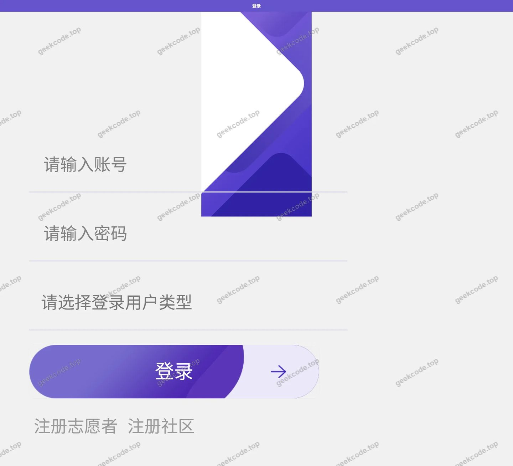</a>

<h3>微信小程序用户端</h3>

<figure><figcaption>小程序-登录</figcaption></figure>
<figure><figcaption>小程序-个人信息</figcaption></figure>
<figure><figcaption>小程序-活动报名列表</figcaption></figure>
<figure><a href="https://geekcode.top/archives/%E5%9F%BA%E4%BA%8E%E5%BE%AE%E4%BF%A1%E5%B0%8F%E7%A8%8B%E5%BA%8F%E7%9A%84%E7%A4%BE%E5%8C%BA%E5%BF%97%E6%84%BF%E8%80%85%E6%9C%8D%E5%8A%A1%E5%B9%B3%E5%8F%B0-8xh87?utm_source=github" title="查看完整源码">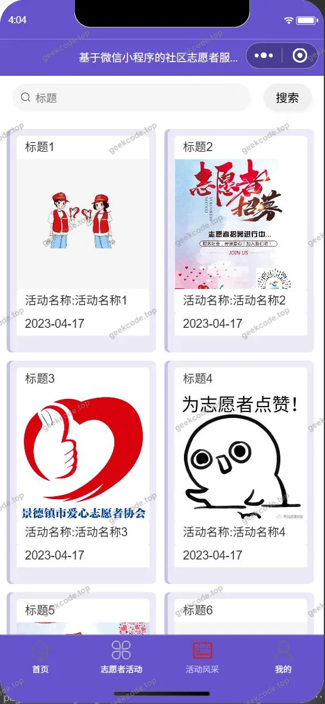</a><figcaption>小程序-活动风采</figcaption></figure>
<figure><figcaption>小程序-活动签到列表</figcaption></figure>
<figure><a href="https://geekcode.top/archives/%E5%9F%BA%E4%BA%8E%E5%BE%AE%E4%BF%A1%E5%B0%8F%E7%A8%8B%E5%BA%8F%E7%9A%84%E7%A4%BE%E5%8C%BA%E5%BF%97%E6%84%BF%E8%80%85%E6%9C%8D%E5%8A%A1%E5%B9%B3%E5%8F%B0-8xh87?utm_source=github" title="查看完整源码">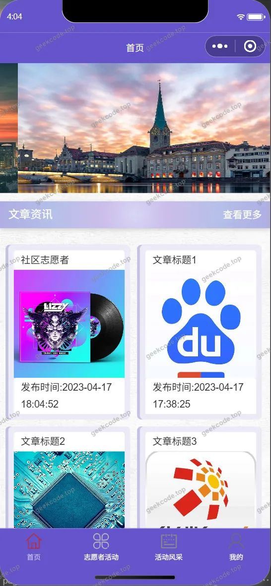</a><figcaption>小程序-首页</figcaption></figure>
<figure><a href="https://geekcode.top/archives/%E5%9F%BA%E4%BA%8E%E5%BE%AE%E4%BF%A1%E5%B0%8F%E7%A8%8B%E5%BA%8F%E7%9A%84%E7%A4%BE%E5%8C%BA%E5%BF%97%E6%84%BF%E8%80%85%E6%9C%8D%E5%8A%A1%E5%B9%B3%E5%8F%B0-8xh87?utm_source=github" title="查看完整源码">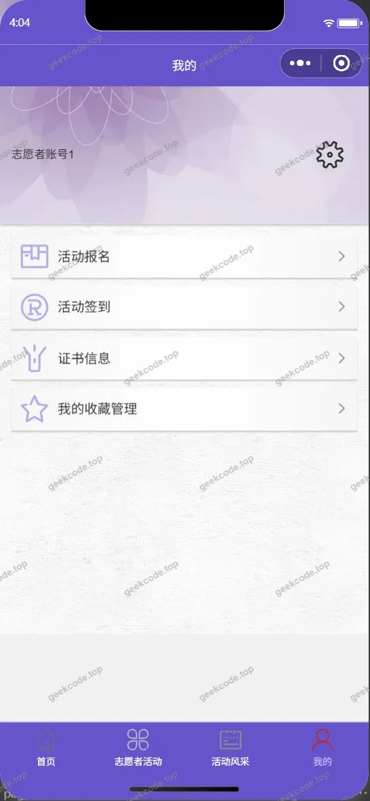</a><figcaption>小程序-我的</figcaption></figure>
<figure><a href="https://geekcode.top/archives/%E5%9F%BA%E4%BA%8E%E5%BE%AE%E4%BF%A1%E5%B0%8F%E7%A8%8B%E5%BA%8F%E7%9A%84%E7%A4%BE%E5%8C%BA%E5%BF%97%E6%84%BF%E8%80%85%E6%9C%8D%E5%8A%A1%E5%B9%B3%E5%8F%B0-8xh87?utm_source=github" title="查看完整源码">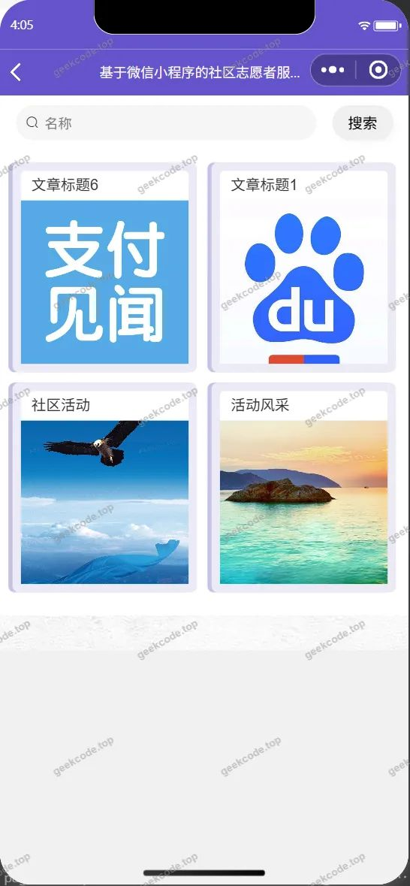</a><figcaption>小程序-我的收藏列表</figcaption></figure>
<figure><figcaption>小程序-证书信息列表</figcaption></figure>
<figure><a href="https://geekcode.top/archives/%E5%9F%BA%E4%BA%8E%E5%BE%AE%E4%BF%A1%E5%B0%8F%E7%A8%8B%E5%BA%8F%E7%9A%84%E7%A4%BE%E5%8C%BA%E5%BF%97%E6%84%BF%E8%80%85%E6%9C%8D%E5%8A%A1%E5%B9%B3%E5%8F%B0-8xh87?utm_source=github" title="查看完整源码">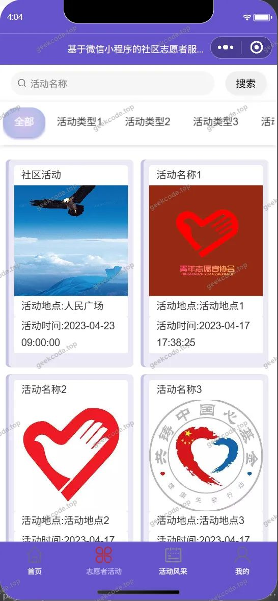</a><figcaption>小程序-志愿者活动</figcaption></figure>
<figure><a href="https://geekcode.top/archives/%E5%9F%BA%E4%BA%8E%E5%BE%AE%E4%BF%A1%E5%B0%8F%E7%A8%8B%E5%BA%8F%E7%9A%84%E7%A4%BE%E5%8C%BA%E5%BF%97%E6%84%BF%E8%80%85%E6%9C%8D%E5%8A%A1%E5%B9%B3%E5%8F%B0-8xh87?utm_source=github" title="查看完整源码">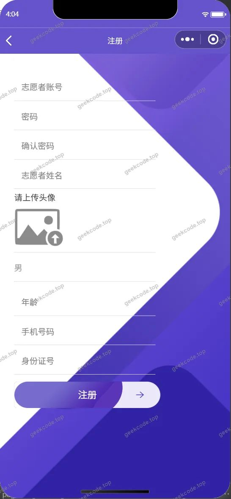</a><figcaption>小程序-注册</figcaption></figure>

<h3>微信小程序管理端</h3>

<figure><figcaption>小程序-管理端-活动类型列表</figcaption></figure>
<figure><a href="https://geekcode.top/archives/%E5%9F%BA%E4%BA%8E%E5%BE%AE%E4%BF%A1%E5%B0%8F%E7%A8%8B%E5%BA%8F%E7%9A%84%E7%A4%BE%E5%8C%BA%E5%BF%97%E6%84%BF%E8%80%85%E6%9C%8D%E5%8A%A1%E5%B9%B3%E5%8F%B0-8xh87?utm_source=github" title="查看完整源码">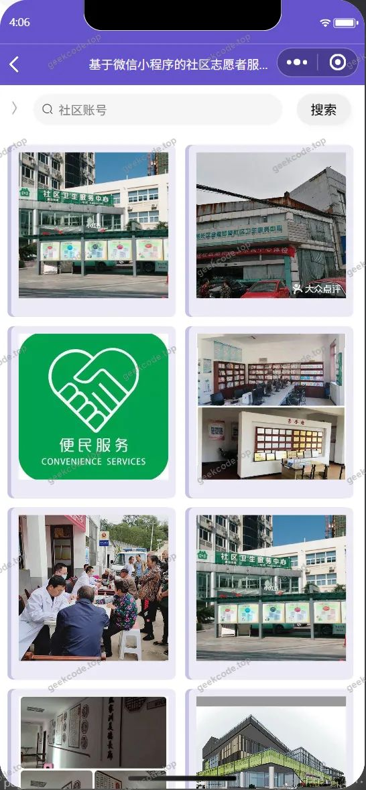</a><figcaption>小程序-管理端-社区列表</figcaption></figure>
<figure><a href="https://geekcode.top/archives/%E5%9F%BA%E4%BA%8E%E5%BE%AE%E4%BF%A1%E5%B0%8F%E7%A8%8B%E5%BA%8F%E7%9A%84%E7%A4%BE%E5%8C%BA%E5%BF%97%E6%84%BF%E8%80%85%E6%9C%8D%E5%8A%A1%E5%B9%B3%E5%8F%B0-8xh87?utm_source=github" title="查看完整源码">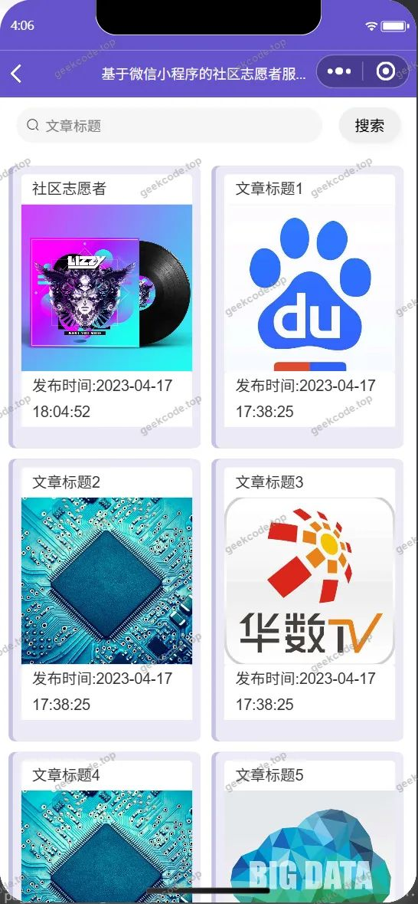</a><figcaption>小程序-管理端-文章资讯列表</figcaption></figure>
<figure><figcaption>小程序-管理端-志愿者列表</figcaption></figure>

<h3>后台管理端</h3>
<h4>后台-登录页</h4>

<h4>后台-活动风采</h4>

<a href="https://geekcode.top/archives/%E5%9F%BA%E4%BA%8E%E5%BE%AE%E4%BF%A1%E5%B0%8F%E7%A8%8B%E5%BA%8F%E7%9A%84%E7%A4%BE%E5%8C%BA%E5%BF%97%E6%84%BF%E8%80%85%E6%9C%8D%E5%8A%A1%E5%B9%B3%E5%8F%B0-8xh87?utm_source=github" title="查看完整源码">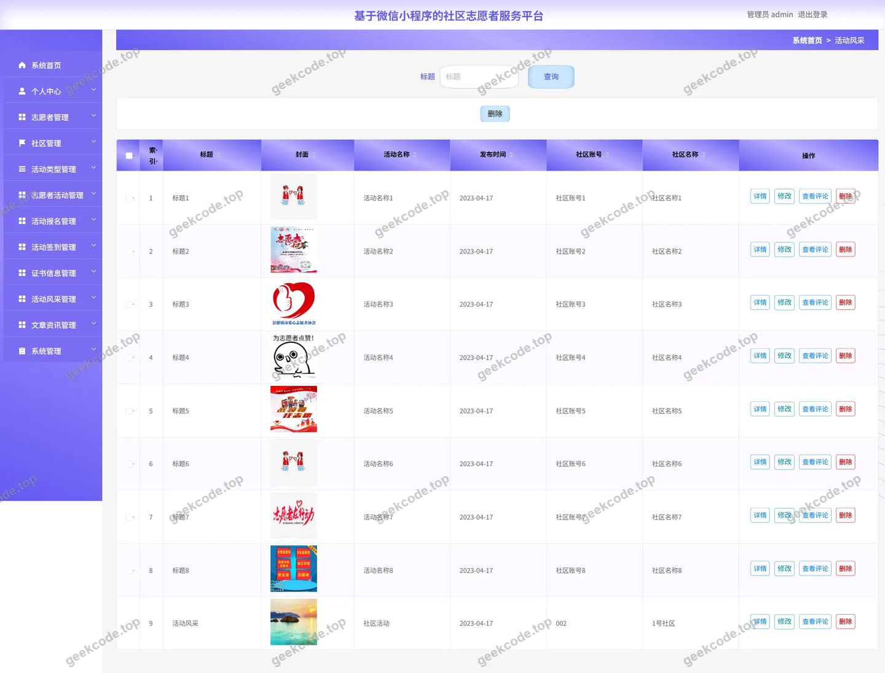</a>

<h4>后台-收藏</h4>

<a href="https://geekcode.top/archives/%E5%9F%BA%E4%BA%8E%E5%BE%AE%E4%BF%A1%E5%B0%8F%E7%A8%8B%E5%BA%8F%E7%9A%84%E7%A4%BE%E5%8C%BA%E5%BF%97%E6%84%BF%E8%80%85%E6%9C%8D%E5%8A%A1%E5%B9%B3%E5%8F%B0-8xh87?utm_source=github" title="查看完整源码">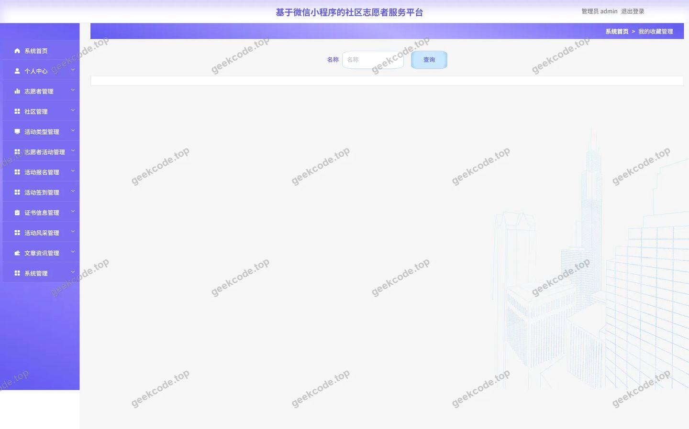</a>

<h4>后台首页</h4>

<a href="https://geekcode.top/archives/%E5%9F%BA%E4%BA%8E%E5%BE%AE%E4%BF%A1%E5%B0%8F%E7%A8%8B%E5%BA%8F%E7%9A%84%E7%A4%BE%E5%8C%BA%E5%BF%97%E6%84%BF%E8%80%85%E6%9C%8D%E5%8A%A1%E5%B9%B3%E5%8F%B0-8xh87?utm_source=github" title="查看完整源码">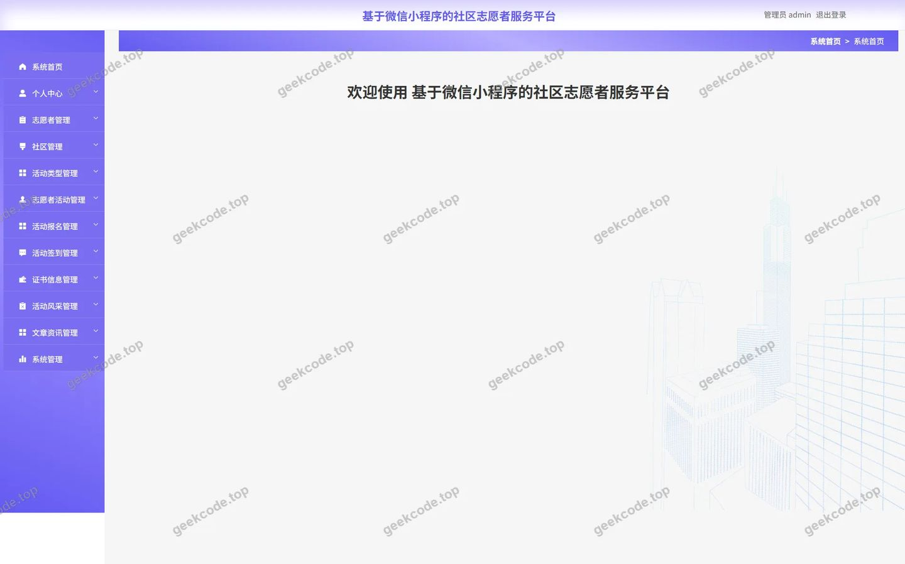</a>

<h4>后台-文章资讯</h4>

<a href="https://geekcode.top/archives/%E5%9F%BA%E4%BA%8E%E5%BE%AE%E4%BF%A1%E5%B0%8F%E7%A8%8B%E5%BA%8F%E7%9A%84%E7%A4%BE%E5%8C%BA%E5%BF%97%E6%84%BF%E8%80%85%E6%9C%8D%E5%8A%A1%E5%B9%B3%E5%8F%B0-8xh87?utm_source=github" title="查看完整源码">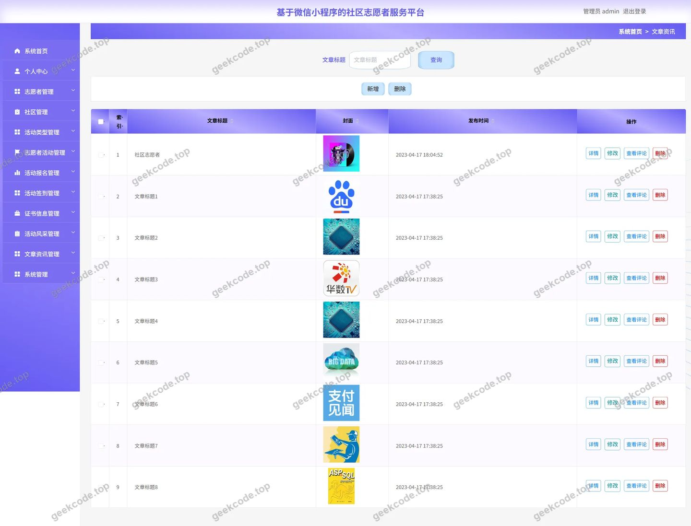</a>

<h4>后台-证书信息</h4>

<a href="https://geekcode.top/archives/%E5%9F%BA%E4%BA%8E%E5%BE%AE%E4%BF%A1%E5%B0%8F%E7%A8%8B%E5%BA%8F%E7%9A%84%E7%A4%BE%E5%8C%BA%E5%BF%97%E6%84%BF%E8%80%85%E6%9C%8D%E5%8A%A1%E5%B9%B3%E5%8F%B0-8xh87?utm_source=github" title="查看完整源码">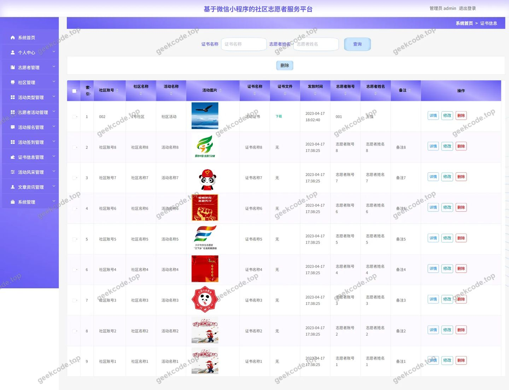</a>

<h4>后台-志愿者活动</h4>

<a href="https://geekcode.top/archives/%E5%9F%BA%E4%BA%8E%E5%BE%AE%E4%BF%A1%E5%B0%8F%E7%A8%8B%E5%BA%8F%E7%9A%84%E7%A4%BE%E5%8C%BA%E5%BF%97%E6%84%BF%E8%80%85%E6%9C%8D%E5%8A%A1%E5%B9%B3%E5%8F%B0-8xh87?utm_source=github" title="查看完整源码">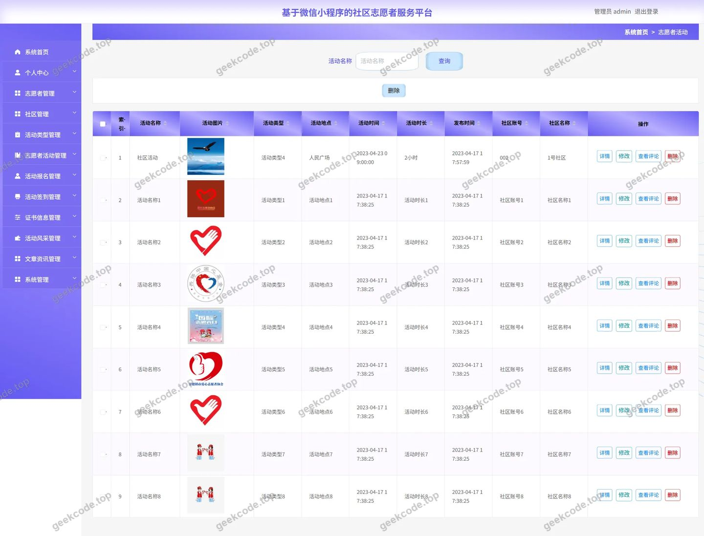</a>

<h4>后台-志愿者活动评论</h4>

<a href="https://geekcode.top/archives/%E5%9F%BA%E4%BA%8E%E5%BE%AE%E4%BF%A1%E5%B0%8F%E7%A8%8B%E5%BA%8F%E7%9A%84%E7%A4%BE%E5%8C%BA%E5%BF%97%E6%84%BF%E8%80%85%E6%9C%8D%E5%8A%A1%E5%B9%B3%E5%8F%B0-8xh87?utm_source=github" title="查看完整源码">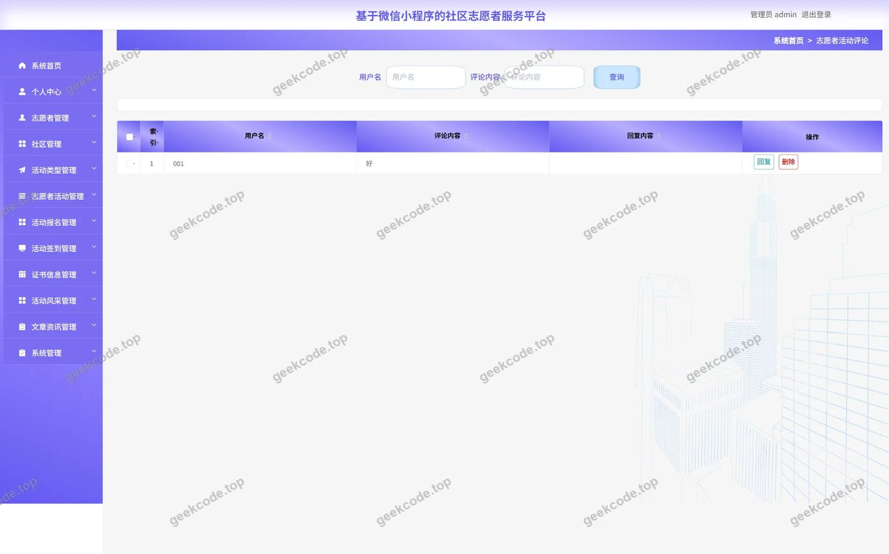</a>

---

## 获取完整源码

| 项目 | 说明 |
| --- | --- |
| 项目名 | 基于微信小程序的社区志愿者服务平台 8xh87 |
| 运行截图 | 本文 24 张（站点带水印原图，仓库 `images/` 目录） |
| 完整源码 | [https://geekcode.top/archives/%E5%9F%BA%E4%BA%8E%E5%BE%AE%E4%BF%A1%E5%B0%8F%E7%A8%8B%E5%BA%8F%E7%9A%84%E7%A4%BE%E5%8C%BA%E5%BF%97%E6%84%BF%E8%80%85%E6%9C%8D%E5%8A%A1%E5%B9%B3%E5%8F%B0-8xh87?utm_source=github](https://geekcode.top/archives/%E5%9F%BA%E4%BA%8E%E5%BE%AE%E4%BF%A1%E5%B0%8F%E7%A8%8B%E5%BA%8F%E7%9A%84%E7%A4%BE%E5%8C%BA%E5%BF%97%E6%84%BF%E8%80%85%E6%9C%8D%E5%8A%A1%E5%B9%B3%E5%8F%B0-8xh87?utm_source=github) |
| 咨询微信 | **ir9372**（备注：jingpin-yuanma） |
| 更多项目 | [极客代码 geekcode.top](https://geekcode.top/?utm_source=github) |

> 需要源码、部署、改配置、跑不起来等问题，加微信 ir9372 沟通，说明项目名即可。
